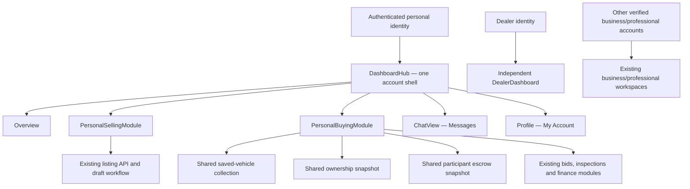

# KAYAD Personal Account — Deep Source Audit and Unified Dashboard Consolidation

**Date:** 16 November 2026  
**Scope:** Personal-account dashboard, buying and private-selling journeys, navigation, saved vehicles, ownership, messages, auctions, deals/escrow, account profile, legacy routes and business-account boundaries.

## 1. Executive outcome

KAYAD now has one canonical authenticated personal-account shell: `src/components/DashboardHub.tsx`.

The former `BuyerPlatform` and `PrivateSellerPlatform` page components have been retired as standalone pages and replaced by content modules:

- `PersonalBuyingModule` — buying, saved vehicles, owned vehicles, auction activity, inspections, financing and participant escrow.
- `PersonalSellingModule` — personal listing creation, drafts, listing management, listing quality and auction eligibility.

Both modules are rendered inside `DashboardHub`. Neither owns a second account header, dashboard hero, dashboard sidebar or separate account navigation. The canonical personal profile remains the existing `Profile` component supplied by `App.tsx`.

The personal account can buy and sell privately from one identity. Dealer, garage/workshop, inspection-company and inspector/mechanic account types and their independent business/professional workflows remain separate.

No database migration, account-record rewrite, API replacement, Git commit, push or deployment was performed.

## 2. Pre-edit audit: findings from source inspection

The previous implementation had two personal-account dashboard routes:

1. `App.tsx` rendered `DashboardHub` for `nav=dashboard`.
2. `App.tsx` separately rendered `PrivateSellerPlatform` for `nav=seller-platform` / `seller-dashboard`.
3. The selling CTA sent personal users into the seller page, which had a separate shell, sidebar and account navigation.
4. `BuyerPlatform` was a separate content/dashboard page with its own hero and summary presentation, despite buying being a capability of the same personal identity.
5. Seller data was loaded inside the seller page while ownership data was loaded in `DashboardHub`; this caused fragmented data ownership and duplicate/uneven refresh behaviour.
6. Seller escrow was fetched separately from participant escrow, so the same personal deal activity could appear through two account paths.
7. Saved vehicles were already managed globally by `useVehicleCollections`, but the buying module fetched favorites again instead of consuming that canonical session-aware collection.
8. Messages, profile, saved vehicles and payments could still be reached through separate personal routes instead of selecting the matching section in the account shell.
9. Legacy buyer/seller URLs could still lead users toward the old page identities.
10. The old broker role had a separate seller-dashboard configuration even though it is not one of the five public registration account types.

## 3. Implemented canonical architecture

### Canonical dashboard sections

- Overview
- My Vehicles
- Buying
- Messages
- Auctions
- Deals & Escrow
- Listing quality
- My Account

Persistent actions:

- Sell a vehicle — opens Create Listing inside `DashboardHub`.
- Browse vehicles — opens the existing public marketplace.

Mobile account navigation remains five items: **Home, Search, Sell, Messages, Account**.

## 4. Source changes

### Canonical shell and route handling

- `src/components/DashboardHub.tsx`
  - Owns the single personal dashboard shell and section navigation.
  - Embeds buying and selling content modules.
  - Centralizes loading for personal listings, ownership and escrow overview.
  - Displays real overview metrics: My Listings, Saved Vehicles, Open Deals and Owned Vehicles.
  - Uses independent loading/error states; failed data is not shown as a false zero.
  - Adds a request-generation guard so late responses from a previous account/refresh cannot overwrite the active account's dashboard state.
  - Persists section selection in the URL so browser back/forward and deep links remain coherent.
  - Removes the old broker Seller Dashboard presentation; the unsupported legacy broker role receives an account-update/support notice instead.

- `src/App.tsx`
  - Renders `DashboardHub` as the authenticated personal dashboard.
  - Normalizes personal `chat`, `profile`, `settings`, `saved` and `payments` destinations into Messages, My Account, Buying and Deals sections.
  - Routes legacy `/buyer-platform`, `/seller-platform`, `/seller-dashboard`, `/sell` and related query navigation into the canonical dashboard sections.
  - Keeps dealer dashboard routing independent.
  - Embeds the existing ChatView and Profile into the canonical dashboard.
  - Chat actions for deals, inspections and financing now select the corresponding personal dashboard section.

- `src/utils/navLocation.ts`, `src/utils/knownRoutes.ts`, `src/utils/authRoutes.ts`, `src/components/navigation/navConfig.ts`
  - Preserve old links as compatibility redirects; they no longer render separate buyer or seller dashboards.
  - Legacy participant-deals navigation resolves to the personal Deals section.

- `src/components/MobileBottomNav.tsx`, `src/components/Navbar.tsx`
  - Sell, Messages and Account navigation align with the unified personal shell.
  - The mobile dock reflects the active dashboard section and keeps safe-area spacing.

### Buying and selling content modules

- `src/features/OwnershipPlatform/pages/PersonalBuyingModule.tsx`
  - Replaces the former `BuyerPlatform.tsx` page.
  - Is content-only; it has no second dashboard hero or account shell.
  - Receives the ownership snapshot and saved-vehicle collection from the canonical app/dashboard data sources.
  - Retains bids, inspections, financing and participant escrow functionality.
  - Does not issue a second ownership or favorites request.

- `src/features/PrivateSellerPlatform/pages/PersonalSellingModule.tsx`
  - Replaces the former `PrivateSellerPlatform.tsx` page.
  - Is content-only; its standalone seller sidebar, seller dashboard shell, duplicate settings surface, seller-home metrics and duplicate escrow dashboard were removed.
  - Receives the real listing collection from `DashboardHub` instead of fetching a second copy.
  - Retains the existing listing wizard, API, drafts, photo validation, listing lifecycle, listing-quality tools and auction verification.
  - Personal listing creation is gated by email verification in the UI; the existing backend seller-listing permission and email-verification checks remain authoritative.
  - Does not offer a separate seller application or seller account.

- `src/features/OwnershipPlatform/index.ts`, `src/features/PrivateSellerPlatform/index.ts`
  - Export the new content-module names.

- `src/components/SellerCapabilityPanel.tsx`
  - Removed because its duplicate seller-entry panel is no longer part of the unified personal account flow.

### Shared personal data and participant deals

- `src/hooks/useVehicleCollections.ts`
  - Exposes the active account's saved-vehicle session key and a refresh action.
  - Masks the previous account's saved vehicles during account changes.
  - Uses only the active account's confirmed saved IDs for optimistic changes.
  - Prevents stale toggle responses from an earlier account from updating the current account's UI.

- `src/features/escrow/ParticipantEscrowDesk.tsx`
  - Accepts the canonical dashboard escrow snapshot.
  - Does not perform a duplicate initial participant-overview request when embedded in the personal dashboard.
  - Refreshes the parent dashboard after participant actions so the Open Deals metric and deal list remain synchronized.

- `src/features/FinancePlatform/pages/FinanceMarketplace.tsx`, `src/features/InspectionsView.tsx`, `src/features/EscrowView.tsx`, `src/features/VehicleMarketplace/components/VehicleMarketplace.tsx`, `src/components/sell/SellPage.tsx`
  - Personal CTAs and account entry points converge on the unified dashboard while preserving public marketplace and public explainer journeys where those are still required.

### Tests and repeatable validators

- Updated/renamed component tests:
  - `src/__tests__/features/PersonalBuyingModule.test.tsx`
  - `src/__tests__/features/PersonalSellingModuleGate.test.tsx`
  - `src/__tests__/utils/navLocation.test.ts`
  - `src/__tests__/components/MobileBottomNav.test.tsx`
  - `src/__tests__/components/EscrowView.test.tsx`

- Updated existing source validators to assert the new architecture rather than the retired dashboard routes.
- Added package command: `npm run validate:personal-account-unification`.

## 5. Data-source ownership and accuracy

| Dashboard data | Canonical source | Handling |
|---|---|---|
| My Listings | Existing `getMyListings()` service | Loaded once by DashboardHub and passed into My Vehicles / listing-quality / auction eligibility modules |
| Saved Vehicles | Existing `useVehicleCollections` hook | Shared session-masked collection; no second favorites fetch in PersonalBuyingModule |
| Owned Vehicles | Existing `getOwnershipDashboard()` service | Loaded once by DashboardHub and passed to PersonalBuyingModule |
| Open Deals | Existing `getMyEscrowOverview()` service | Loaded once by DashboardHub and reused by ParticipantEscrowDesk |
| Auction bids | Existing `fetchMyBids()` service | Loaded by the Auctions section with account-key masking and an explicit unavailable state |
| Messages | Existing ChatView and chat APIs | Embedded in the Messages section |
| Profile/security | Existing Profile component | Single My Account surface |

**Not fabricated:** The source did not expose a dedicated seller-enquiry count/aggregate API or a unified recent-activity feed. Therefore, no fake Active Enquiries or Recent Activity numbers were added. Messages remain accessible in the unified dashboard. Those summary items can be added once an authoritative endpoint is identified.

## 6. Account and business boundaries

The five public registration choices remain unchanged:

1. Personal account
2. Dealer
3. Garage / workshop
4. Inspection company
5. Inspector or mechanic

The public Personal account option continues to map to the canonical backend `user` role. The historical registration intent key `buyer` is an internal compatibility identifier, not a separate buyer account or dashboard. Legacy `individual_seller` rows continue to resolve to the personal dashboard. No database role migration was introduced.

Dealer accounts continue to use the independent `DealerDashboard` and business workspace. Dealership membership, staff roles, business ownership, verification and business inventory were not migrated or attached to personal-account ownership. Revocation of staff membership remains governed by the existing business-membership system.

## 7. Validation performed

### Repeatable source-contract suite

`npm run validate:personal-account-unification` passed the following validators:

| Validator | Result |
|---|---:|
| Unified personal account consolidation | 22/22 |
| Unified selling module | 11/11 |
| Personal buying module convergence | 13/13 |
| Unified account shell | 11/11 |
| Navigation convergence | 43/43 |
| Private listing workflow | 12 workflow stages passed |
| Public escrow boundary | 14/14 |
| Public financing boundary | 23/23 |
| Personal data/security boundaries | 29/29 |
| Registration role matrix | 34/34 |

### Syntax checks

- TypeScript/TSX transpilation syntax checks passed for 17 changed source/test files.
- The global `tsc --noEmit` command could not provide a valid project typecheck because dependencies/type packages are not installed in this source workspace. The available global compiler also reports existing type inference errors in `Navbar.tsx` around its focus-management query; these are not evidence of a passing full typecheck.

### Not completed

- Production Vite build.
- Vitest/Jest runtime suites.
- Authenticated browser journeys.
- Visual browser tests at 320, 360, 390, 430, tablet and desktop widths.
- Live API integration tests for listing creation, escrow actions and account switching.

The available Node runtime is 22.16.0, while the project requires Node >=22.22.2. Dependencies are absent. Runtime/production certification is therefore **not claimed**.

## 8. Remaining work before release

1. Install dependencies under Node >=22.22.2 and run the full TypeScript and production build.
2. Run all frontend/backend runtime regression suites.
3. Run authenticated browser journeys for buying, private listing creation, editing, drafts, publication, messages, auctions, escrow and profile/security.
4. Test account switching and saved-vehicle masking in a real browser.
5. Test desktop, tablet and 320–430px mobile layouts, especially the fixed five-item dock and content clearance.
6. Identify an authoritative seller-enquiries summary endpoint and a real recent-activity source before adding those dashboard metrics.
7. Perform dealer staff membership revocation tests without altering either personal or business ownership.

## 9. Release status

**Source consolidation:** implemented.  
**Standalone personal buyer/seller dashboard flows:** retired from the authenticated personal route graph.  
**Personal data ownership:** consolidated for listings, saved vehicles, ownership and participant escrow overview.  
**Business account separation:** preserved.  
**Production certification:** outstanding.  
**Git commit/push/deployment:** not performed.

Final rule: **one personal identity, one dashboard, buying and private selling as sections, and separate verified business accounts.**
